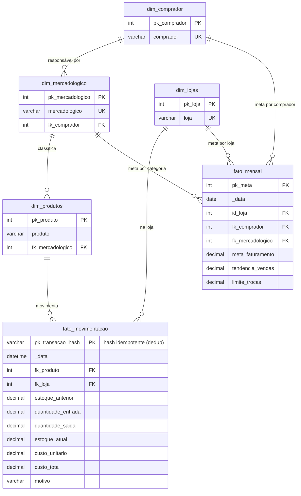

# Gestão de Trocas, Devoluções & Prevenção de Perdas

Relatório desenvolvido em **Power BI** para o monitoramento de trocas, devoluções e prevenção de
perdas em uma rede varejista. O painel mapeia os motivos das devoluções, identifica filiais e
fornecedores críticos e mensura o impacto financeiro da perda, apoiando as equipes de Operações e
Prevenção de Perdas na ação sobre a causa raiz.

---

## Visão Geral

Toda devolução carrega um custo — financeiro, operacional e de relacionamento — que raramente é
consolidado. Esta solução reúne as ocorrências de troca, seus motivos e os cadastros de produtos e
lojas em um modelo único, transformando um problema difuso em um mapa claro de onde, por que e
quanto se perde.

> **Nota de confidencialidade:** todos os dados exibidos no arquivo `.pbix` são fictícios e
> anonimizados, criados exclusivamente para demonstração de portfólio.

---

## Contexto de Negócio

Devolução tratada como evento isolado esconde padrões. Quando as ocorrências são analisadas em
conjunto, aparecem os motivos recorrentes (defeito, validade, desacordo comercial), as filiais com
incidência acima da média e os fornecedores que puxam o índice para cima. Sem essa visão, a empresa
absorve a perda de forma passiva, sem base para negociar com fornecedor nem para corrigir processo.

O painel expõe esses padrões e o custo associado, deslocando a gestão de reativa para preventiva.

## O Problema que Resolve

- **Perda absorvida passivamente**, sem mensuração do custo total de devoluções.
- **Motivos de devolução não consolidados**, impedindo ação sobre a causa raiz.
- **Filiais e fornecedores críticos invisíveis** na análise caso a caso.
- **Falta de base objetiva** para negociação com fornecedor problemático.

## Público e Decisões Apoiadas

- **Prevenção de perdas:** ataca as causas raiz e reduz a incidência.
- **Compras / Comercial:** negocia com fornecedores de maior índice de devolução.
- **Operações:** identifica filiais críticas e padroniza processos.

## Impacto e Valor Gerado

Expôs os motivos, as filiais e os fornecedores com mais devolução e o custo financeiro da perda,
permitindo atacar a causa raiz e negociar com o fornecedor problemático — reduzindo perda e
melhorando o resultado operacional.

---

## Arquitetura de Dados e Abordagem Técnica

### Fontes de dados
- **Ocorrências de troca / devolução** (com motivo e valor).
- Cadastros de **produtos** e **lojas / filiais**.
- Base de suporte tratada em Excel (`Para analise, tendência de trocas.xlsm`).

### Transformação (Power Query / M)
Tratamento das ocorrências de troca, padronização de motivos, associação com cadastros de produto e
loja e cálculo do custo por ocorrência. A base auxiliar em Excel é integrada e higienizada na camada
de consulta.

### Modelagem dimensional (Star Schema)
- **Fato Ocorrências de Troca** — grão por devolução (quantidade e valor).
- **Dimensão Filial** — unidade onde ocorreu.
- **Dimensão Motivo** — classificação da causa.
- **Dimensão Produto / Fornecedor** — item e origem.

### Principais medidas (DAX) — lógica implementada

```DAX
Qtd de Trocas       = COUNTROWS( FatoTrocas )
Custo Total Trocas  = SUM( FatoTrocas[Valor] )
Taxa de Devolucao % = DIVIDE( [Custo Total Trocas], [Faturamento Bruto] )
Trocas por Filial   = CALCULATE( [Qtd de Trocas], ALLEXCEPT( DimFilial, DimFilial[Filial] ) )
```

> As fórmulas descrevem a lógica de cálculo do relatório e servem como referência de leitura do modelo.

---

## Indicadores e Análises (KPIs)

- **Volume & Custo Total de Trocas:** quantidade e montante financeiro de produtos devolvidos.
- **Taxa de Devolução (% sobre vendas):** proporção entre vendas brutas e devoluções por filial.
- **Matriz de Motivos de Devolução:** classificação das causas (defeito, validade, desacordo, etc.).
- **Ranking de Filiais & Fornecedores:** unidades e fabricantes com maior índice de ocorrências.

## Estrutura de Páginas do Relatório

1. **Visão Geral de Perdas** — volume, custo total e taxa de devolução.
2. **Motivos de Devolução** — matriz de causas e sua participação.
3. **Ranking Crítico** — filiais e fornecedores com maior incidência.

## Como Visualizar

O relatório é apresentado pelas imagens da seção **Prints** abaixo, que reproduzem as páginas
principais do painel. O arquivo-fonte (`.pbix`) e as planilhas de suporte não são versionados
neste repositório por conterem o modelo de dados; podem ser disponibilizados sob solicitação para
avaliação técnica.

## Estrutura de Arquivos

```text
README.md    -> Documentacao do projeto (contexto de negocio + arquitetura tecnica)
docs/        -> Prints das paginas do relatorio
.gitignore   -> Exclui binarios (.pbix) e planilhas de trabalho do versionamento
```

## Prints

As imagens abaixo apresentam as páginas principais do relatório — a imagem é o que comunica o
projeto de forma imediata. Os prints serão adicionados na pasta `docs/`.

<!-- Descomente ao adicionar a imagem:

-->

## Autor

Vitor Santos — Análise de Dados e Inteligência Comercial (Varejo).

## 🗺️ Modelo de Dados (DER)

Modelo dimensional do banco MySQL `trocas`, com **duas fatos**: `fato_movimentacao` (entradas/saídas de estoque de trocas, com saldo e custo) e `fato_mensal` (metas e limites por comprador/categoria). Renderizado pelo GitHub via Mermaid. *Dados fictícios de demonstração.*



### 📐 Métricas e cálculos derivados (camada analítica / DAX)
- **Saldo de estoque** (`estoque_atual`) recalculado a cada movimentação (`estoque_anterior + entrada − saída`)
- **Custo total** = `quantidade × custo_unitário` (impacto financeiro da perda)
- **Trocas × limite**: % de devoluções frente ao `limite_trocas` definido por comprador/categoria
- **Meta × realizado**: `tendencia_vendas` e `meta_faturamento` vs. movimentação real
- **Qualidade de dados**: `pk_transacao_hash` garante idempotência (sem duplicatas na carga)

## ⚙️ ETL, Qualidade de Dados & Modelo físico
Pipeline que alimenta o painel (consolidado neste repositório):
- **`sql/schema.sql`** — DDL real do banco MySQL `trocas` (exportado via `SHOW CREATE TABLE`).
- **`etl/`** — scripts Python (Pandas + SQLAlchemy): carga do fluxo de trocas e rotinas de **qualidade de dados** (`normalizar_banco.py`, `corrigir_banco.py`, `fix_duplicatas.py`) com chave-hash idempotente.
